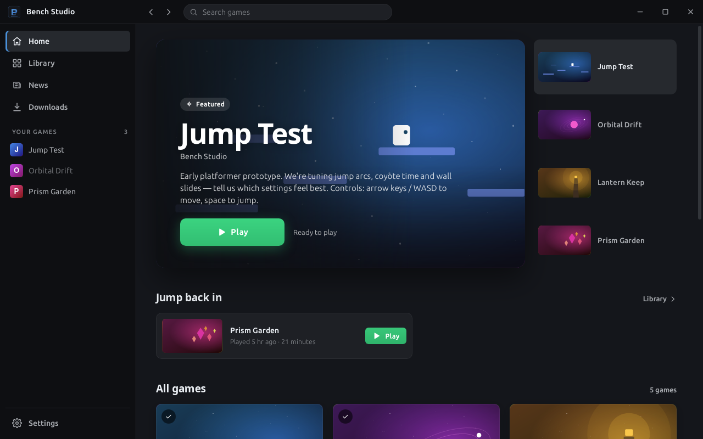

# Toybox

A lightweight, brandable game launcher for sharing prototype builds with friends,
family and small playtest groups — no zips over email, no accounts, no backend.

Players install the launcher once. It reads a `catalog.json` from any static host,
lets them add games to their library, installs them with one click, verifies
every download (sha256), and keeps them updated automatically whenever you bump
a version number. An optional RSS feed powers the News tab.

Out of the box it's **Toybox**, a general launcher that players fill with catalogs from
several publishers: one `toybox://add?url=…` link per catalog, all in a single library
(see [Multiple catalogs](#multiple-catalogs)). Studios can also fork it into **a branded
launcher** with their own catalog built in (see [Making it yours](#making-it-yours)).



Built with Rust + [Tauri 2](https://tauri.app). The UI is plain HTML/CSS/JS
(no bundler) in `ui/`.

## Quick start

```bash
npm install                      # installs the Tauri CLI
python3 examples/make-demo.py    # generates two demo catalogs in examples/
npm run dev                      # debug builds auto-load examples/launcher.json
```

The demo config is a branded "Bench Studio" launcher with `examples/demo/` built in (and
`allowAddingCatalogs` switched on). To try multi-catalog mode, add `examples/demo-arcade/catalog.json` ("Night Shift Arcade") in
Settings → Catalogs.

Linux needs the usual [Tauri prerequisites](https://tauri.app/start/prerequisites/)
(WebKitGTK 4.1 etc). `npm run build` produces installers in
`src-tauri/target/release/bundle/` (.deb/.rpm/.AppImage, .msi/.exe on Windows,
.dmg/.app on macOS).

## Making it yours

The default `src-tauri/launcher.json` is Toybox itself: no built-in catalog, adding
catalogs allowed, self-updating from this repo's GitHub releases. To make a studio's
branded launcher instead:

1. Edit **`src-tauri/launcher.json`**. It's compiled into the binary:

   ```json
   {
     "name": "Bench Studio",
     "tagline": "Playtest builds from the bench",
     "logo": "https://example.com/logo.png",
     "catalogUrl": "https://example.com/catalog.json",
     "rssUrl": "https://example.com/news.xml",
     "updateUrl": "https://example.com/launcher/version.json",
     "theme": { "primary": "#14161b", "accent": "#4a90d9" }
   }
   ```

   The whole palette (surfaces, borders, text, light/dark) is derived from
   `primary` (background) and `accent` (buttons and highlights). A light `primary` gives a light theme.

   | Field | Meaning |
   |---|---|
   | `catalogUrl` | The built-in catalog. Leave it empty for a general launcher that starts with no catalogs (like Toybox). |
   | `allowAddingCatalogs` | Let players add other catalogs (Settings, `toybox://` links). Defaults to `true` without a `catalogUrl` and `false` with one, so a branded launcher sticks to its catalog and ignores `toybox://` links unless you opt in. |
   | `keepBranding` | With `allowAddingCatalogs`, keep this `theme` even when several catalogs are added (by default the launcher switches to a neutral theme then). |
   | `rssUrl`, `updateUrl` | News feed and [launcher self-update](#updating-the-launcher-itself). Optional. |
   | `updatePublicKey` | Only accept launcher updates signed with this key (see [Signed updates](#signed-updates)). Recommended whenever `updateUrl` is set. |

2. In `src-tauri/tauri.conf.json`, change `productName` and `identifier`.
   The identifier decides where user data is stored, so give your fork its own.
3. Unless you allow adding catalogs, delete `plugins.deep-link` from `tauri.conf.json`
   so your installer doesn't claim `toybox://` links from players who also have Toybox.
   (A single-catalog launcher ignores them anyway and never registers the scheme itself.)
4. Replace the icons in `src-tauri/icons/` (`npx tauri icon your-logo.png` generates the full set).
5. `npm run build` and send your players the installer.

An existing build can be pointed somewhere else without recompiling. Config is
looked up in this order:

| Priority | Location |
|---|---|
| 1 | `$TOYBOX_CONFIG` (path to a JSON file) |
| 2 | `launcher.json` next to the executable |
| 3 | `launcher.json` in the user config dir (Settings → Configuration shows the path) |
| 4 | *debug builds only:* `examples/launcher.json` |
| 5 | the compiled-in `src-tauri/launcher.json` |

`catalogUrl`, `rssUrl`, `updateUrl` and `logo` may be `https://` URLs, `file://` URLs or
plain paths (relative paths resolve against the config file).

## Catalog format

```json
{
  "version": "2026-11-08",
  "name": "Bench Studio playtests",
  "publisher": "Bench Studio",
  "games": [
    {
      "id": "jump-test",
      "name": "Jump Test",
      "version": "0.3.1",
      "description": "Early platformer prototype",
      "downloadUrl": "builds/jump-test-0.3.1.zip",
      "sha256": "105a3091…",
      "executable": "JumpTest.exe",
      "icon": "art/jump-icon.png"
    }
  ]
}
```

The top-level `name`, `publisher`, `icon`, `description`, `website`, `supportUrl` and
`accent` (a `#rrggbb` colour) are all optional. They describe the catalog itself: they're
shown when a player adds it, in Settings → Catalogs, and next to its games once a launcher
follows several catalogs. In that mode `accent` also tints the catalog's game pages.

For each game, required: `id` (letters, digits, `-` `_` `.`; unique within the catalog), `name`, `version`, and a `downloadUrl` and
`executable` (either at the top level or per platform). Browser games are the exception: they
only need a `playUrl` (see below). Everything else is optional:

| Field | Purpose |
|---|---|
| `sha256` | Hex digest of the zip. Downloads that don't match are rejected. Strongly recommended. |
| `args` | Array of command-line arguments passed to the executable. |
| `icon` | Square artwork (sidebar, game page). |
| `banner` | 16:9 artwork for cards and the hero. Falls back to the icon, then to generated art. |
| `screenshots` | Array of image URLs shown in a gallery. |
| `tags`, `developer`, `released` | Shown on cards and the game page. |
| `releaseNotes` | Plain text shown under "What's new". |
| `size` | Download size in bytes (used before the download starts). |
| `featured` | `true` puts the game in the home page spotlight. |
| `feedbackUrl` | Where players report problems (see below). Defaults to the catalog's `supportUrl`. |
| `platforms` | Per-OS overrides: `{ "windows": { "downloadUrl", "sha256", "executable", "args", "size" }, "macos": {…}, "linux": {…} }`. |

### Report a problem

When a game has a `feedbackUrl`, or its catalog has a `supportUrl`, the game page shows
**Report a problem** (in the sidebar and the ⋯ menu). It opens that link pre-filled:

- A **web page** can use placeholders, which are filled in URL-encoded:
  `{game}`, `{gameId}`, `{version}` (the build the player has, else the catalog's),
  `{catalog}`, `{launcherVersion}` and `{platform}` (e.g. `windows x86_64`). This works
  with prefilled form links, for example Google Forms'
  `https://docs.google.com/forms/d/e/…/viewform?entry.123={game}&entry.456={version}`.
  A link without placeholders opens as-is.
- A **`mailto:` link** gets a subject and a body with those details, unless it sets its own.

Players can add more detail with **Settings → Help → Copy diagnostics** (below).

### Browser games

Games that run in a web page, such as three.js, Babylon, PlayCanvas, Phaser or Godot/Unity web
exports, skip the download entirely. Give them a `playUrl` instead of `downloadUrl`/`executable`:

```json
{
  "id": "prism-garden",
  "name": "Prism Garden",
  "playUrl": "https://games.example.com/prism-garden/",
  "openIn": "window",
  "banner": "art/prism-banner.png"
}
```

- Players get **Add to library** instead of Install, and then **Play**.
- `openIn: "window"` (the default) opens the game in its own launcher window. The launcher
  tracks the session like any other game: "Playing" state, a Close button, and play time.
  `openIn: "browser"` hands the URL to the system browser instead.
- `version` is optional. The page is always the latest build, so there are no installs or
  updates to manage.
- Relative `playUrl`s resolve against the catalog, so a game can sit in the same folder
  (`"playUrl": "web/prism-garden/index.html"`). Local folders work for testing, but some
  engines need to be served over http(s), for example to load modules or WASM.
- Game windows have **no access to the launcher's internal commands**: Tauri's
  permissions only cover the main window, so a page can't touch the library or files.

Notes:

- **Relative URLs** resolve against the catalog's own URL, so one folder holding
  `catalog.json`, `builds/` and `art/` can be uploaded anywhere (S3, GitHub
  Pages, itch.io, a NAS share…) as-is.
- **Updates** are triggered when a game's `version` differs from the installed one,
  using a plain string comparison. Rolling back works the same way: publish the old version again.
- **Zips** may contain the files at the root or wrapped in a single folder.
  `executable` is the path inside that folder, such as `Bin/Game.exe`. On macOS it may
  name a `.app` bundle. Unix permissions and symlinks are preserved, and the
  executable is always marked executable.

## Multiple catalogs

A launcher can follow several catalogs ("sources") at once, from different publishers.
All their games share one library, and nothing needs a server beyond static files.

- **Single-catalog mode** is a launcher with one catalog, typically a branded build with
  `catalogUrl` set. It uses the config's name, logo and theme. Unless its config sets
  `allowAddingCatalogs: true`, players can't add catalogs and it ignores `toybox://`
  links completely (it doesn't register the scheme, come to the front, or show a dialog).
- **Multi-catalog mode** starts when a second catalog is added. Games are grouped by
  catalog on the home page, cards and game pages show which catalog a game comes from, the
  Library can be filtered by catalog, and the theme turns neutral (unless `keepBranding`
  is set) while each catalog's `accent` colours its own game pages.

**Adding a catalog** (when the launcher allows it). From Settings → Catalogs → *Add catalog* (a URL or a local path), or
with a link:

```
toybox://add?url=https%3A%2F%2Fexample.com%2Fcatalog.json&name=Example%20Games
```

`url` is required and must be http(s) (URL-encode it); `name` is optional and used until
the catalog provides its own. The launcher opens (or comes to the front), fetches the
catalog, and asks the player to confirm, showing its publisher, description and game
count, with a reminder to only add catalogs from people they trust. Nothing is added
without that confirmation. Put the link on a web page or send it in a message. If the
launcher isn't installed yet, the link does nothing, so link to the installer too.

The `toybox` scheme is declared in `tauri.conf.json` (`plugins.deep-link`), which Tauri's
bundler turns into installer registration: `x-scheme-handler/toybox` in the `.deb`/`.rpm`
desktop entry (via `src-tauri/linux/toybox.desktop`, which adds the `%u` the default
template lacks), and the URL scheme in the Windows installers and the macOS Info.plist.
The portable Windows build and the AppImage also register it themselves at startup.
Debug builds leave the system alone; set `TOYBOX_REGISTER_PROTOCOL=1` to register one.
Only the Linux side has been tested so far. A fork can change the scheme in
`tauri.conf.json` and `PROTOCOL` in `src-tauri/src/catalogs.rs`.

**Managing catalogs.** Settings → Catalogs lists each one with its status, and lets the
player turn it off (its games stay installed and playable, but get no updates), check it
now, or remove it. The built-in catalog from `catalogUrl` can be turned off but not
removed. Removing a catalog keeps its library games. Adding the same catalog again later
reconnects them. *Export catalog list* (the ⋯ menu) writes `toybox-catalogs.json` to the
Downloads folder; give that file (its path or a URL) to *Import a catalog list…* or *Add
catalog* on another computer to add them all.

**How it's stored.** `sources.json` in the app data folder holds the catalogs. Library
entries are keyed `"<sourceId>:<gameId>"` and record both ids, so two publishers can use
the same game id. Games install to `games/<sourceId>/<gameId>/`, and each catalog has its
own offline cache in `cache/sources/`. Catalogs are re-checked with `ETag` /
`Last-Modified`, so an unchanged catalog costs one small request. A library from before
multi-catalog support is migrated on first start: its games move under the config's
catalog (source id `default`).

## Publishing a new build

```bash
python3 tools/publish.py path/to/catalog.json jump-test 0.3.2 dist/JumpTest.zip \
    --notes "Faster jumps, fewer bugs"
# then upload the zip + catalog.json
```

The script records the sha256, size and date, and bumps the catalog `version`. Use
`--platform windows|macos|linux` for per-OS builds, and `--url` if the zip is
hosted somewhere other than next to the catalog.

Launchers check the catalog at startup, every 30 minutes, and when the player
clicks **Check now**. By default updates install automatically. A game that is
running gets updated after it closes.

## Updating the launcher itself

When `updateUrl` is set in `launcher.json`, the launcher keeps itself up to date
from a static `version.json`:

```json
{
  "version": "0.2.0",
  "minimumVersion": "0.1.5",
  "released": "2026-11-08",
  "notes": "Faster downloads\nFixed a crash on exit",
  "page": "https://example.com/download",
  "platforms": {
    "linux":   { "url": "Toybox_0.2.0_amd64.AppImage", "sha256": "…", "size": 91234567 },
    "windows": { "url": "toybox-0.2.0-windows.zip", "sha256": "…", "executable": "toybox.exe" },
    "macos":   { "url": "Toybox-0.2.0-macos.zip", "sha256": "…" }
  }
}
```

| Field | Meaning |
|---|---|
| `version` | The current launcher release. It's offered to any launcher reporting an older version (compared numerically: `0.10.0` > `0.9.2`, and `1.0.0-beta` < `1.0.0`). |
| `minimumVersion` | *Optional.* Launchers older than this are **required** to update. Games can't be installed or played until they do. This is only enforced when the update can actually be installed, either automatically or via `page`. |
| `platforms` | One build per OS: `linux`, `windows`, `macos`, or `<os>-<arch>` such as `macos-aarch64` (the more specific key wins). With no entry for its platform, a launcher isn't offered the update. |
| `sha256` | **Required.** The launcher never replaces itself with unverified bytes. |
| `version.json.sig` | *A separate file*, required when the launcher has `updatePublicKey` (see [Signed updates](#signed-updates)). |
| `url` | The raw executable/AppImage, or a zip containing it (`executable` names it if it isn't called the same as the running file). On macOS it must be a zip containing the `.app` bundle. Relative URLs resolve against `version.json`. |
| `notes`, `released` | Shown to the player. |
| `page` | *Optional.* A manual download page, linked when the launcher can't update itself. |
| `allowDowngrade` | *Optional.* Also offer `version` to launchers that are *newer*, for pulling a bad release. |

The launcher checks at startup, every 30 minutes, and from Settings → **Check now**.
New builds download in the background (Settings has a toggle for this) and are swapped
in either when the player clicks **Restart to update**, or silently the next time the
launcher is closed. Restarting waits until no games are running and no downloads
are in progress.

To publish a launcher release (once per platform):

```bash
python3 tools/publish-launcher.py path/to/version.json 0.2.0 \
    src-tauri/target/release/bundle/appimage/Toybox_0.2.0_amd64.AppImage \
    --platform linux --notes "What changed" [--minimum 0.1.5] [--page https://…]
# then upload the AppImage + version.json
```

Bump `version` in `src-tauri/tauri.conf.json` (and `Cargo.toml`) before building. That's the version the launcher reports.

### Signed updates

A sha256 in `version.json` only proves the download matches `version.json`. Whoever can
change files on your update host could change both. Signing closes that: with
`"updatePublicKey"` in `launcher.json`, the launcher only accepts a `version.json` that comes
with a valid Ed25519 signature in `version.json.sig` next to it, and refuses (and logs)
anything else.

```bash
python3 tools/sign.py keygen ~/toybox-signing.key   # once; prints the public key
# add the printed "updatePublicKey" to src-tauri/launcher.json, then for each release:
python3 tools/sign.py sign path/to/version.json --key ~/toybox-signing.key
# upload version.json and version.json.sig together
```

Keep the private key out of the repo and back it up. If it's lost, launchers with the
old public key can't be updated automatically any more. The release workflow signs for
you when the `LAUNCHER_SIGNING_KEY` secret is set:
`gh secret set LAUNCHER_SIGNING_KEY < ~/toybox-signing.key`. To change keys, ship
a release signed with the old key whose `launcher.json` has the new public key.
`tools/sign.py` needs only Python's standard library.

### Building releases with GitHub Actions

`.github/workflows/release.yml` does all of the above for every platform. Bump the
version in `src-tauri/tauri.conf.json` and `src-tauri/Cargo.toml`, then push a matching
tag:

```bash
git tag v0.2.0 && git push origin v0.2.0
```

It runs the tests, builds Linux (x86_64), Windows (x64) and macOS (Apple Silicon and
Intel), and opens a **draft release** containing:

| File | For |
|---|---|
| `.AppImage`, `.deb`, `.rpm` | Linux installs (the AppImage is also the self-update artifact) |
| `-setup.exe`, `.msi` | Windows installers |
| `_windows_x64_portable.zip` | Portable Windows build, and the self-update artifact |
| `.dmg` | macOS installs |
| `_macos_<arch>.app.zip` | macOS self-update artifacts |
| `version.json` | The self-update manifest, already pointing at this release's files |
| `version.json.sig` | Its signature, if the `LAUNCHER_SIGNING_KEY` secret is set |

Check the draft and publish it. Launchers built with
`"updateUrl": "https://github.com/<owner>/<repo>/releases/latest/download/version.json"`
then see it as the latest version. Tags with a pre-release suffix (`v0.3.0-1`) become
pre-releases, which `latest` skips. MSI only accepts numeric pre-release suffixes, so
use `-1`, not `-beta`. Running the workflow by hand (*Actions → Release → Run
workflow*) builds everything as downloadable artifacts without creating a release.

The builds aren't code-signed, so Windows SmartScreen and macOS Gatekeeper will warn
on first launch (on macOS, right-click → *Open*). The launcher downloads self-updates
itself, without the browser's quarantine/"downloaded from the internet" flag, so they
shouldn't trigger the warning again (unverified on Windows and macOS).

**What can update itself:** the Linux AppImage, Windows, and macOS `.app` installs in
a folder the user can write to. Installs in system locations, like the `.deb`/`.rpm`
packages in `/usr/bin` or an MSI under `Program Files`, can't replace themselves. They
show the update with a link to `page`. Debug builds never replace themselves; set
`TOYBOX_ALLOW_SELF_UPDATE=1` to test the flow.

## How it behaves

- **Interrupted downloads:** a dropped connection is retried, continuing where it
  stopped (HTTP `Range`). If it still fails, the partial file is kept and **Retry**
  continues it, even after a restart (partial downloads are kept for 7 days). Servers
  without range support just start over. The sha256 check covers the whole file either way.
- **Disk space:** before downloading, and again before unpacking, the launcher checks
  there's room (plus a small margin) and says how much is needed, instead of failing halfway.
- **Logs and diagnostics:** the launcher logs what it does (catalog checks, installs,
  launches, game exit codes, and errors, including the UI's) to `toybox.log` in the
  platform's log folder (1 MB, plus one older file). **Settings → Help** opens that
  folder, and **Copy diagnostics** copies a plain-text report (versions, platform,
  catalog status, installed games, recent log) for players to paste into a bug report.
- **Offline:** each catalog's last good copy is cached separately, as is the news
  feed. Installed games stay playable, and a banner names any catalog that's offline.
- **Safe installs:** the zip is downloaded and hashed, extracted to a staging folder
  (zip-slip protected), and then swapped in for the old version. A failed or
  cancelled update leaves the previous install untouched.
- **Library:** what's added, installed versions, play time and last played are
  stored in `library.json` in the app data folder (Settings → Storage).
- **Keeping old versions:** each game page has an **Installed versions** panel with a
  per-game *Keep previous versions* switch. When it's on, an update moves the old build to
  `games/<sourceId>/.versions/<id>/<version>/` instead of deleting it. The Play button then gets a ▾
  menu to choose *Latest* or any kept build, and each kept build can be played, opened or
  deleted from the panel. *Keep up to* caps how many old builds are kept (default 3, or
  *All versions*); the oldest are deleted past the limit, but never one that's playing.
  *Delete all previous versions* (also in the game's ⋯ menu) clears them in one go.
  Uninstalling a game removes its kept builds too.
- **Games removed from the catalog:** the library keeps a snapshot of each game's catalog
  entry (art, description, type), so a removed game still looks right. Installed and kept
  builds stay playable but get no updates and can't be reinstalled; removed browser games
  and never-installed games show *No longer available* with a *Remove from library*
  button. The launcher shows a notification when a library game disappears on a refresh.
  Games from a catalog that's turned off or removed behave the same way, with a note
  saying so.

## Project layout

```
src-tauri/src/
  config.rs     launcher.json loading
  sources.rs    the catalogs a launcher follows (sources.json), export/import
  catalogs.rs   loading/refreshing every catalog, adding sources, toybox:// links
  catalog.rs    catalog model, per-platform build resolution
  location.rs   URL / local path handling, relative resolution
  installer.rs  download (resumable) → verify → extract → swap, auto-updates, disk space
  selfupdate.rs launcher self-update from version.json (optionally signed)
  support.rs    log file, diagnostics report, "Report a problem" links
  runner.rs     launching games (processes + browser-game windows), play-time tracking
  library.rs    persisted library state
  news.rs       RSS/Atom parsing
  lib.rs        Tauri commands + app setup
ui/             index.html, styles.css, js/ (app, views, store, util, icons)
examples/       demo config + generator for two local demo catalogs
tools/          publish.py (games), publish-launcher.py (launcher releases), sign.py (update signing)
docs/           README screenshot
.github/        release workflow (GitHub Actions)
```

Run the tests with `cd src-tauri && cargo test`.

## License

This project is released under the [CC0 Public Domain Dedication](https://creativecommons.org/publicdomain/zero/1.0/).
You may fork, adapt, reuse, or ignore it freely.

[](http://questioncopyright.org/promise)

> ["Make art not law"](http://questioncopyright.org/make_art_not_law_interview) - Nina Paley